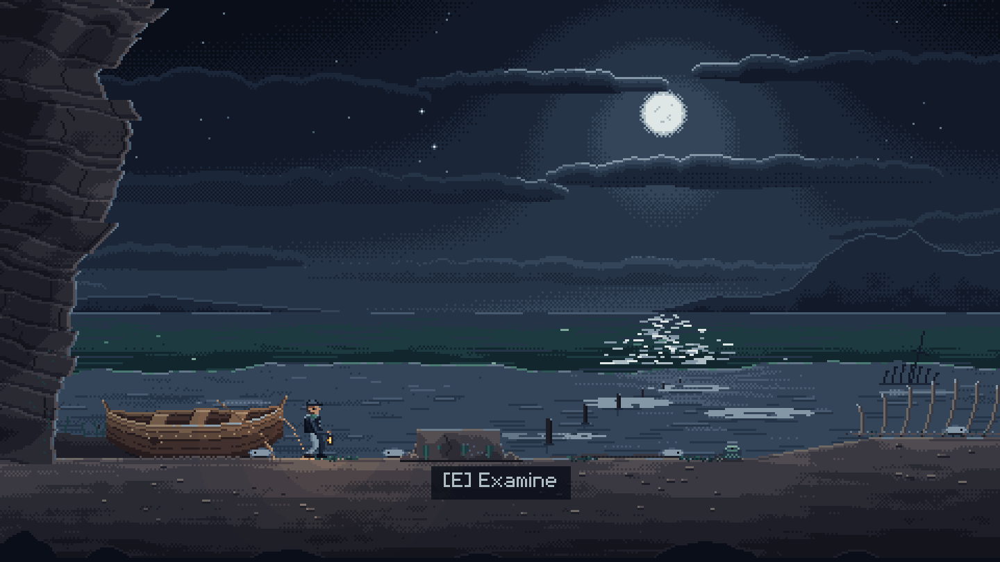

# DAGON: Beneath the Black Tide

A short 2D horror game. A shipwrecked sailor wakes beside his boat on a stretch of seabed that should be under the ocean, and walks out across it to find where the sea has gone. Made for [GitHub Game Off 2026](https://itch.io/jam/game-off-2026), whose theme is SHIFT.



**An alpha:** playable from beginning to end, and still unfinished. Walk, jump, examine what you find, and keep going.

## Download

Every release is on the **[Releases page](https://github.com/shamsuzzamansadi/dagon/releases)**. All are prereleases. The latest is **[`v0.2.0-alpha.1`](https://github.com/shamsuzzamansadi/dagon/releases/tag/v0.2.0-alpha.1)**:

| System | File |
|---|---|
| Windows, 64-bit | [`dagon-v0.2.0-alpha.1-windows-x86_64.zip`](https://github.com/shamsuzzamansadi/dagon/releases/download/v0.2.0-alpha.1/dagon-v0.2.0-alpha.1-windows-x86_64.zip) |
| Linux, 64-bit | [`dagon-v0.2.0-alpha.1-linux-x86_64.tar.gz`](https://github.com/shamsuzzamansadi/dagon/releases/download/v0.2.0-alpha.1/dagon-v0.2.0-alpha.1-linux-x86_64.tar.gz) |
| macOS, Apple Silicon | Not in a release yet. The Mac build is new since `v0.2.0-alpha.1`, and comes with the next prerelease as `dagon-<version>-macos-arm64.zip` |

Each release also has `SHA256SUMS.txt`, to check a download (`sha256sum -c SHA256SUMS.txt` on Linux, `shasum -a 256 <file>` on a Mac, `Get-FileHash <file>` in PowerShell), and `PROVENANCE.txt`, which names the commit and the CI run that built it. There is no build for Intel Macs, phones or the web.

## Play

**Windows.** Extract the whole zip, keeping its files together, and run `dagon.exe`. The game is not code-signed, so Windows may say it protected your PC: choose **More info**, then **Run anyway**.

**Linux.**

```sh
tar xzf dagon-v0.2.0-alpha.1-linux-x86_64.tar.gz
cd dagon-v0.2.0-alpha.1-linux-x86_64
./dagon.x86_64
```

**macOS, on an Apple Silicon Mac** (M1 or later, Pro, Max and Ultra included), **macOS MACOS_MIN or later.** Double-click the zip to unpack it; you can move **APP_NAME** to Applications. The app is signed ad hoc, without an Apple developer identity, and is not notarized, so macOS blocks it the first time:

- **macOS 15 Sequoia and later:** open the app, and choose **Done** when macOS says it could not verify it. Open **System Settings**, then **Privacy & Security**, scroll down to **Security**, and choose **Open Anyway** beside the message about the app. Confirm with **Open Anyway** and your password.
- **macOS 11 to 14:** Control-click the app, choose **Open**, then **Open** again.

After that it opens like any other app.

The game opens on its main menu. **New Game** starts from the beginning; **Continue** carries on from your last checkpoint. **Settings** has the volumes, subtitles, controller vibration, a window or fullscreen, and your own keys.

## Controls

| Action | Keyboard | Xbox controller | PlayStation controller |
|---|---|---|---|
| Walk | A / D, or ← / → | Left stick, D-pad | Left stick, D-pad |
| Jump | Space | A | Cross |
| Examine, when a prompt shows; again to skip a line | E | X | Square |
| Pause | Esc | Menu | Options |
| Menus | Arrow keys, Enter, Esc | Stick or D-pad, A, B | Stick or D-pad, Cross, Circle |

Other controllers use the same buttons by position. The prompts name the buttons of whatever you are using. Walk, jump and examine can be moved to other keys in Settings.

## Where it stands

- **The latest release is M5's game,** the fifth of seven milestones. `main` holds M6, stabilization: a fullscreen setting, fixes to what the game shows, and the Mac build. M7 prepares the jam submission ([roadmap](docs/roadmap.md)).
- **Not yet checked by people:** play by first-time players, and how long a first playthrough takes; whether the reveal's dialogue can be made out by ear; physical Xbox and PlayStation controllers; the owner's own Windows and Linux machines; any Mac. The release notes list what each release has not been tested for.
- **Sound:** every sound is synthesized, and the narration is an AI-generated voice ([CREDITS.md](CREDITS.md)).

The current state, in detail, is in [docs/handoff.md](docs/handoff.md); how releases are made and checked is in [docs/release.md](docs/release.md).

## Build it yourself

You need Git, Python 3, Godot **4.7.2-stable**, and a C++20 compiler: GCC 11 or newer on Linux, Visual Studio 2022 on Windows, or Xcode on an Apple Silicon Mac. Gameplay is C++ through GDExtension, built with SCons against the `godot-cpp` submodule. Versions, and why, are in [docs/toolchain.md](docs/toolchain.md).

```sh
git clone --recurse-submodules https://github.com/shamsuzzamansadi/dagon.git
cd dagon
python3 -m venv .venv && .venv/bin/pip install scons==4.9.1
.venv/bin/scons platform=linux target=template_debug      # or platform=windows
.venv/bin/scons platform=linux target=template_release
.venv/bin/scons unit_tests
sh tools/prepare_project.sh                               # before opening the project the first time
godot --path project
```

On Windows, use `.venv\Scripts\scons` and `tools\prepare_project.ps1`; add `require_msvc=yes` to make sure SCons uses Visual Studio. On a Mac, use `platform=macos` and add `arch=arm64 macos_deployment_target=11.0` to the two builds.

The checks CI runs, locally (on Windows, from Git Bash). `GODOT` is the Godot 4.7.2 executable; `tools/install_godot.sh` fetches it, checked against its SHA-512.

```sh
GODOT=/path/to/godot sh tools/run_godot_checks.sh            # import, extension load, integration tests, smoke runs
sh tools/install_export_templates.sh                         # export templates, SHA-512 checked
GODOT=/path/to/godot sh tools/export_check.sh linux          # or windows, or macos on a Mac: export, run, and test the pack
python tools/art/check_art.py                                # the art's palette, ground and edges
```

The scripts give every Godot process its own storage folder, so they never touch your own settings or save. The game's design is in [docs/gdd.md](docs/gdd.md), its structure in [docs/architecture.md](docs/architecture.md), and its decisions in [docs/decisions.md](docs/decisions.md).

## How this was made

- **AI-assisted development.** The source code, tests, CI and documents are written mainly by Claude (Anthropic) through Claude Code, under the project owner's direction. The pixel art is drawn by Python scripts that Claude wrote and tuned, with no image generators or third-party art. ChatGPT (OpenAI) acts as an independent reviewer. The owner makes the decisions and does the playtesting. Details: [docs/jam.md](docs/jam.md) §5.
- **Before the jam.** Planning documents and a toolchain probe were written on 2026-10-28, and the empty repository was created that day. No game code was written before the jam started (log: [docs/jam.md](docs/jam.md) §6).
- **Starting point.** The build files derive from the official [godot-cpp-template](https://github.com/godotengine/godot-cpp-template).

## License

Code is under the [MIT License](LICENSE). Original game assets are under CC BY 4.0. Third-party components and asset provenance are listed in [CREDITS.md](CREDITS.md).
