# M3 Review Package

**To:** ChatGPT (independent reviewer), and the owner for the manual check. **Date:** 2026-11-04.
**Status: implemented, awaiting independent review. Not accepted by the owner.** The owner played a build from before the last three changes and found it improved, but not yet a sufficiently engaging game ([record](../evidence/m3/owner-playtest-2026-11-04.md)). M3 is not merged, and no tag or release has been made. **[§12](#12-engagement-where-it-stands-and-what-i-propose) is the part that most needs a decision.** Any reviewer, please state which checks you rerun and which rely on the supplied CI evidence.

| | |
|---|---|
| **Repository** | https://github.com/shamsuzzamansadi/dagon |
| **Branch and pull request** | `m3/complete-gameplay`, draft [#3](https://github.com/shamsuzzamansadi/dagon/pull/3) |
| **Base** | `main` at `15ba96c1243d16e2cd1e4c4007348c467296669d`, CI run `41781804077` |
| **The tested code and the build for the owner's check** | **`2ce855a0acad4482bd1fead0c5a13e91451e4f7a`**, CI run **[41818800097](https://github.com/shamsuzzamansadi/dagon/actions/runs/41818800097)** |
| **Acceptance fingerprint of that commit** | `sha256:8645ded9104896405f1df83694c40cf22321ba63b1287f925a2118adf9f18c2e` (`python tools/release_gate.py fingerprint --commit 2ce855a`) |
| **Final HEAD** | A file cannot name its own commit. The pull request and the handoff report name it and its CI run. Every commit after `2ce855a` adds only documents and evidence, so the fingerprint above still applies to it. |
| **Artifacts of that run** | `dagon-windows`: `d293bf4758f20fad1c39eb0765a67eec252ef77634968be4c07c24b32df1b566`. `dagon-linux`: `888d10daf306fb3b5147b19c757124d133b839026d7300d5811059c594378241`. Logs: `logs-linux`, `logs-linux-clang`, `logs-windows` |

**What has been verified by whom.** There has been no independent review of any of this yet.

| Result | Who ran it |
|---|---|
| Native tests, integration tests from source and on the exported pack, on GCC, Clang and MSVC | CI, at `2ce855a` |
| The real exported Linux and Windows release builds, played to the ending, and timed | CI, scripted, at `2ce855a` (§7). Not a person, and not a physical keyboard |
| A fresh clone, built by the README, and repeated runs | Developer, scripted (§6) |
| Deliberate breakage | Developer, scripted (§6). Simulated input only |
| The look of each stretch of the greybox and each stage of the reveal, from captures | Developer. Software rendering only (§3) |
| **How narration sounds** | **The owner: noticeably synthetic, and not an approved final voice.** The developer cannot hear audio. ChatGPT looked at sampled video frames and did not listen (§5) |
| **How vibration feels** | **Nobody yet.** Pending the owner (§10) |
| Earlier builds of this branch | **The owner has played them at least twice.** One led to the narrative update, and a later one to [this feedback](../evidence/m3/owner-playtest-2026-11-04.md). **Neither is a first-time run.** A recording of the earlier one ran about 2 min 40 s with menus |
| The three changes made after the second playtest | **No person has played them yet** (§2, §3) |
| A first-time player | **Nobody, on any build** |
| Independent review | **Not yet done** |

## 1. Delivered

| Scope item | State |
|---|---|
| Continuous route: Shore → Exposed Abyss → Monolith → Witness → escape → collapse → Ending → Main Menu | Built, in one level. Accepted Shore art unchanged, greybox beyond it |
| Clue tablets, and the Wave → Kneel → Eye puzzle | Built, with feedback, rejection and lockout, repeated-input handling and a terminal solved state. **Solution unchanged** |
| `core::SequencePuzzle`, `PuzzleController` | Built as the architecture specifies |
| `GameDirector`: Shore → Abyss → Monolith → Awakened → Witness → Fleeing → Ended | Built, forward only |
| Cinematic contract (architecture §5), with `monolith_awaken`, `dagon_reveal` and `collapse` | Built in full. §4 maps each clause to its test |
| Flee: reaching `collapse`, or 12 s by default | Built. Both reach the same ending |
| Ending → Main Menu → New Game, clean | Built |
| Stable saves at Shore, Abyss, Monolith and Awakened. Witness, Fleeing, Ended, partial attempts and mid-cinematic state never saved | Built. Save format unchanged |
| **Owner's update:** route choices, talisman, ritual and watcher, worship imagery, Innsmouth epilogue | Built, §2 |
| **Owner's update:** staged reveal, recognizable Dagon, visible collapse | Built as placeholders to judge the staging, §3 |
| **Owner's update:** spoken lines, captions by line ID, priorities, skipping, Narration volume, subtitle switch | Built, §5 |
| **Owner's update:** three voice samples | In the build, **for voice direction only. Not an approved voice.** The rest of the script is text, and no more will be generated with this voice |
| **Owner's update:** controller vibration, with a switch | Built, §5. Dispatch and cleanup tested. Feel not |
| **After the owner's playtest, in scope and using only existing verbs:** clues placed so that routes matter, rock across the escape, the sea coming back over the ending ([D67–D69](../decisions.md)) | Built, §2, §3. **They do not answer the feedback in full,** and §12 says what remains |
| CI: GCC, Clang, MSVC, source and exported pack, and the exported route | Green at `2ce855a` |

### Left to M4 and M5, as the owner set out ([roadmap](../roadmap.md))

Final environments, and a coherent transition beyond the Shore. **The owner again found the cave and later art visibly unfinished next to the Shore, and music and sound insufficient. Both are true, and both stay with M4 and M5:** nothing past the Shore is production art, and only the voice samples make any sound. Final ritual imagery, Dagon art, animation, lighting and effects. Music, ambience, footsteps, interaction and cinematic sounds. Approved final narration and the complete mix. Then in M6: timing against the 10–15 minutes, display support, physical controller checks.

### The schedule

**The owner's target of completion before 20 November conflicts with the roadmap's dates,** in which M5 starts on 20 November. The [roadmap](../roadmap.md) has a proposed plan, and the cuts it would take, all to optional embellishment: **it works only if this review and acceptance close by about 6 November,** and two things are outside the developer's control: the owner's answer on the voice, and two external players in three days.

## 2. The route and its connections

Illustrated from the build's own captures, on software rendering. **Placeholder art.** One mark, an eye above a line of waves, runs from the first prop to the last line. Nothing needs it to be noticed.

**The Shore: a talisman.** One sprite in the accepted palette, and one caption. Nothing is collected, and nothing is blocked by missing it.

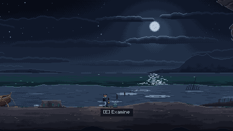

**Beyond the cave entrance: the mark, cut in the wall and kept clean.** A roof and back wall now make the first stretch past the Shore read as a cave.

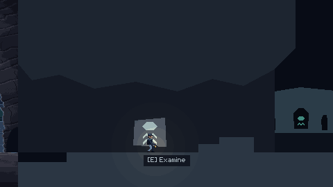

**Where the cave opens: a distant ritual.** Figures kneel around a stone bearing the mark, against a pale haze, while a standing figure moves off behind them. 13 seconds, placed so that a walking player has the watcher on screen for at least 6 of them, and a test holds it to that. The stones stay afterwards. **Background only:** no simulation and no chase.

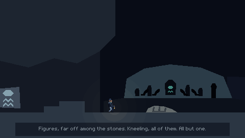

**The first choice of route, now with a stake.** A rock leads up to a shelf, with the ground open beneath it, and both rejoin. **Below,** a recess with a carved procession walking to the sea, **and the second tablet,** which cannot be read from above. **Above,** a cairn looking back the way you came, and a watcher on the far ridge, seen only from there. From the ground, a hop does not reach the shelf.

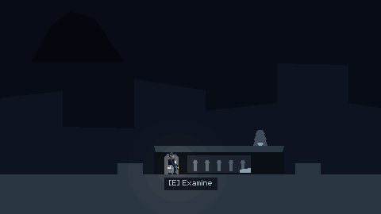
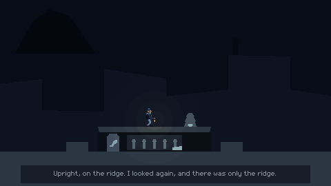

**The second choice, which now takes finding.** From the ground you see a slab up on a shelf, with no way up on this side. Walk under it, find the rock at the far end, and come back along the shelf, past a kneeling statue with a wrong head, to **the third tablet.** It cannot be read from below. On either level, a figure crosses the canyon ahead.

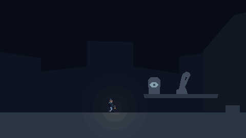

**So where you go decides what you know at the stones** ([D67](../decisions.md)). This replaces "required clues stay on the ground" from D56, because the shelves held only lore, and the owner has said lore alone is not activity. **It can never block anyone:** the mural's fragments show the same order, trial and error always finishes the puzzle, "A third slab" tells a player who missed one that there is one to go back for, and the way back is open. Tests hold all of this. **Its weakness:** with three stones, two clues imply the third, so the stake is small. §12 is frank about that.

**Solving changes the mural in picture and caption.** Before, worn fragments, "Ruins, and nothing more." After, a vast swimmer, rows of figures bowing, the mark above them, and the statues' eyes lit: "These were never ruins."

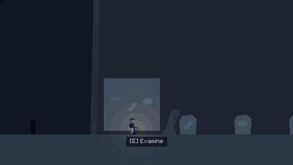
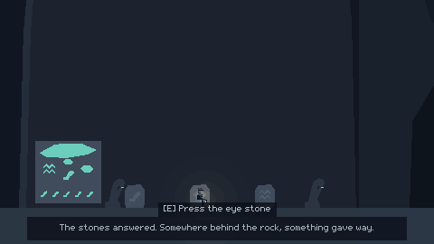

**The epilogue** names Innsmouth: the mark again, in a shop window, on a man who "did not seem to need telling". It suggests a larger world, it is our addition, and it reads without knowing Lovecraft. Its four lines arrive one at a time.

### What comes back after Restart or Continue

No state is saved for any of this ([D63](../decisions.md)). A world is rebuilt from its beat.

| Event | Restored at the Shore or Abyss | Restored at the Monolith or later |
|---|---|---|
| Ritual, ridge watcher, canyon figure | Still ahead, and plays once when reached | Behind you. **Never plays,** even walking back |
| A line spoken on entering the Monolith | Plays on the way in | **Not spoken:** a restored world does not come through there |
| Lines and cues inside clips | Only when the clip plays | No clip plays on restore |
| Examining a prop | Always available, and says its line again | The same |

## 3. The reveal and the ending

The owner asked for: puzzle response → unsettling pause → distant movement → scale reveal → escape cue → escape → visible collapse → fade → epilogue. Having played it, **the owner says the reveal, escape and ending still need a stronger dramatic payoff.** Most of that payoff belongs to art and sound in M5 (§12). The two additions below are what greybox can do now. **Timing is the point of placeholder staging, so please judge it in motion. Stills cannot show it.**

| Stage | Where | Time | What happens |
|---|---|---|---|
| Puzzle response | `monolith_awaken` | 0–3.5 s | Rumble, the mural lights, the gate rises, "The stones answered." |
| Unsettling pause | Same | 3.5–5.5 s | Nothing moves, and the camera holds |
| Distant movement | Same | 5.5–7 s | The far ridge shifts, with a faint tremor. Control returns, and the player walks to the ledge by choice |
| Stillness, then water | `dagon_reveal` | 0–2.5 s | Control locks. Fog thins, and the trench water stirs |
| Scale reveal | Same | 2.5–7 s | The camera pulls right back, and the body and head rise. "It was no ridge." |
| The hand | Same | 5.5–7 s | The arm comes down over the monolith, with the strongest shake and the vibration cue |
| The eye | Same | 9.5–12 s | It opens, and at the end looks toward him |
| Escape cue | Same | 12.2–14 s | "Its head turned. I ran." The camera returns to him, and he turns to face left |
| Escape | Fleeing | 12 s at most | **New:** three falls of rock come down across the ground he walked in on, each with a shake and dust, and each must be hopped. Stopping at one costs time, and the 12 s still end it the same way. About 10 s to `collapse` in the scripted runs, which hop as they go |
| Visible collapse | `collapse` | 0–2.5 s | He stumbles and falls in plain view, and the camera closes in |
| **The sea comes back** | Same | 2.5–5.2 s | **New:** water rises over him and the screen, connecting to the epilogue's "They found me in the shallows" |
| Fade | Same | 4.3–6 s | Then the epilogue |

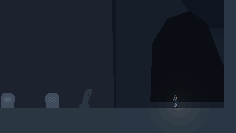
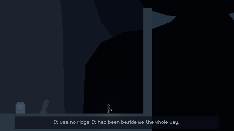
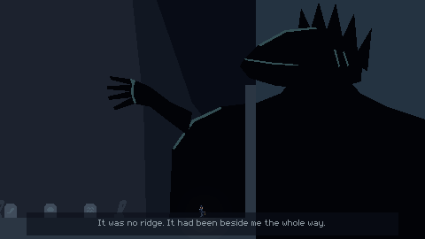
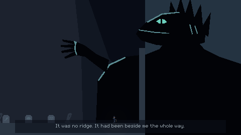
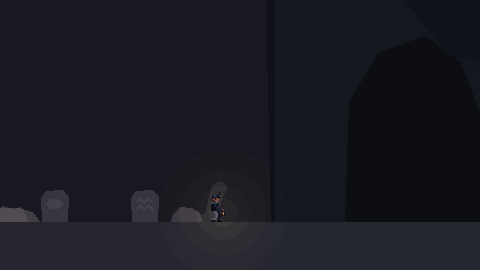
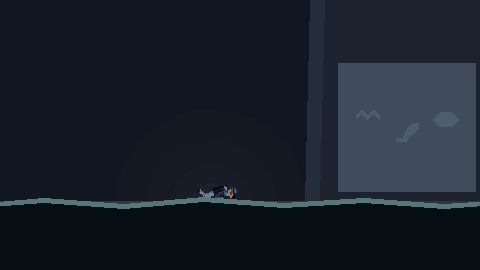

**Dagon:** a head in profile with a heavy brow, a long jaw, gills and a swept-back fin, a neck and shoulders, and a long arm ending in a webbed hand across the monolith's face, in silhouette against a paler sky. Rim highlights pick out the brow, jaw, gills, shoulder and knuckles. Its feet are never seen, and its top is cropped. A far ridge visible from the monolith onward becomes its shoulder.

**Rock and sea:** `GameDirector` gives the rock its collision and shows it, deferred, when the flee begins, so a missing clip changes only the sight of it falling. Each rock lands before someone running flat out could be under it, a test holds it to that, and a restart rebuilds the world without any of it ([D68](../decisions.md)). The sea is a screen-space picture in the clip, and nothing depends on it ([D69](../decisions.md)).

**I looked at each stage, and two earlier drafts did not read:** the head first looked like a one-eyed cat, because its crest read as ears, and the ritual's figures vanished against the dark. Both were redrawn. **It is one developer's reading of stills. The owner has played the reveal and asked for more payoff. The owner has not said whether the shape reads as a head, a body and a hand, so §10 still asks.**

## 4. Implementation map

| Area | Where |
|---|---|
| Puzzle rules | `src/core/sequence_puzzle.*`. `submit(id, now)` returns `Accepted`, `Rejected`, `Solved` or `Ignored`. No clock, no Godot |
| Puzzle adapter | `src/puzzle_controller.*`. Lights, prompts, signals. Time accumulates in `_process`, so it pauses |
| Story rules | `src/core/story_progress.*`. Forward-only `apply`, `restore` of savable beats, `awaited_trigger`, `checkpoint_beat`, `has_player_control` |
| Progression, outcomes, cinematics | `src/game_director.*`. `process_event` → `enter_beat` → `start_cinematic` → `finalize_cinematic` → `after_cinematic` → `run_recheck`. `apply_outcome` is idempotent and plays nothing, so the same call serves a finished clip and a restored world |
| Background events | `GameDirector::on_background_trigger`, `StoryTrigger.spent_from_beat`, the `Background` player |
| Camera | `src/camera_rig.*`. `aim_at`, `add_trauma`, `restore_view` |
| Narration | `project/narration/script.txt`, `src/core/narration.*` (rules), `src/narration.*` (loading), `Hud::say`, `tools/audio/make_narration.py` |
| Vibration | `src/haptics.*`, `GameDirector::haptic_cue`, `_notification` |
| Persistence | `src/core/save_data.*` (format unchanged), `src/game_session.*` (refuses to save unless the Director says it is safe), `GameDirector::restore_start_beat` (the one restore path), `src/core/settings_data.*` (three new values, no new version) |
| Ending | `scenes/ui/ending.tscn`, `MenuController::MODE_ENDING`, `advance_ending`, `GameDirector::go_to_ending` |
| The world | `scenes/level/shore.tscn`: acts, triggers, checkpoints, clips, puzzle wiring, `Rockfall`, `ReturningSea`. Layout in [D48](../decisions.md), [D56](../decisions.md) and [D67](../decisions.md) |
| Test tools | `project/tests/fixtures/story_arena.tscn` (clips of a quarter of a second), `project/tests/route_player.gd` (plays by keys and what is on screen), `tools/route_check.py` (the exported build) |

### Deviations from the approved design

Each is in [decisions.md §8 and §9](../decisions.md). None changes what the player is meant to get.

| Design said | Built | Why |
|---|---|---|
| Overlap rechecks at `recorded + 2` | **`recorded + 3`** (D49) | **The architecture asked M3 to verify this, and it was wrong for the main case.** Measured on 4.7.2 ([evidence](../evidence/m3/overlap-latency.txt)): moved in the physics phase of frame F, the overlap list knows at F + 2. Moved in the idle phase of F, where a clip ends, it knows at F + 3. With + 2, a test saw a trigger fire for a player who had already left |
| `change_scene_to_packed(ending_scene)` in the finalizer | Instantiated and changed with `change_scene_to_node`, from the deferred step (D50) | The tree removes the current scene at once, and a missing clip finalizes inside `body_entered`, where that is an error. The node form sets the active device first, as the main menu does |
| `checkpoint_reached` for every beat | Savable beats only, and `beat_changed` for all (D55) | A save must wait for finalization, which at Awakened differs from entering the beat |
| GlyphLights as `PointLight2D` | `Polygon2D` overlays (D54) | Greybox. `indicators` takes any `CanvasItem` |
| `DagonLayer` in parallax | In world space, with a ridge as the part seen first | Placeholder. M5 replaces it |
| `level.tscn` and the world share one collision | Up to x = 980 (D48) | The world carries on. `level.tscn` stays M1's test scene |
| 11 classes, "add no further abstractions" | **Still 11.** Narration and vibration are stateless files, plus methods on `Hud`, `MenuController` and `GameDirector` (D58, D62) | |
| No application text in a data file | `project/narration/script.txt`, exported by name (D57) | The owner asked for one source for voice and caption |

### Each clause of the cinematic contract

Tests are in `project/tests/test_cinematics.gd` unless named. The middle column is a breakage in the [first pass](../evidence/m3/breakage-first-pass-at-2cae7bb.txt), so you can see what fails.

| Clause | Breakage caught | Test |
|---|---|---|
| Generation-aware: a stale completion has no effect | "No generation guard" | `test_a_stale_completion_has_no_effect_on_a_newer_cinematic` |
| Duplicate completion has no effect | The same | `test_a_duplicate_completion_applies_the_outcome_once`, `test_a_duplicate_reveal_completion_raises_reveal_done_once` |
| A completion for another clip is ignored | "A completion for another clip" | `test_a_completion_for_another_clip_is_ignored` |
| Missing clip recovers, on all three clips and with no clip player | "A missing clip is never finalized" | `test_a_missing_{awaken,reveal,collapse}_clip_*`, `test_a_scene_with_no_clip_player_at_all_still_progresses` |
| Looping clip recovers, and is told apart from a rescue by the watchdog | "A looping clip is played" | `test_a_looping_{awaken,reveal,collapse}_clip_*`, `test_a_ping_pong_awaken_clip_*` |
| Watchdog recovers, at length + 2 s, and stops the clip | "The watchdog never fires", "...ignores the margin", "Finalizing leaves a stuck clip playing" | `test_a_stuck_{awaken,reveal,collapse}_clip_*`, `test_the_watchdog_waits_*`, `test_the_watchdog_stops_a_stuck_clip_*` |
| Starting during a cinematic is refused, and leaves it untouched | "A second start replaces" | `test_starting_a_cinematic_during_one_*` |
| Finalization cannot overwrite a later cinematic's camera or lock | "The follow-up runs inside the finalizer" | `test_a_trigger_already_overlapping_during_finalization_*` |
| Control stays locked up to `RevealDone` | "Control is given back as soon as the reveal finalizes" | `test_the_reveal_keeps_control_locked_right_up_to_reveal_done` |
| Pending events, and their order | "A second pending event", "A pending event is dropped" | `test_a_puzzle_solved_during_a_cinematic_*`, `test_a_second_pending_event_*`, `test_after_a_cinematic_the_steps_run_in_their_order` |
| `call_deferred` is not a physics step | "The recheck waits two frames", "...one frame" | `test_the_recheck_never_trusts_*`, `test_the_recheck_runs_three_physics_frames_*` |
| Trigger during a cinematic: dropped, unconsumed, rechecked | "A trigger during a cinematic moves the story", "...is consumed", "The recheck after a cinematic is never scheduled" | `test_a_trigger_during_a_cinematic_*` |
| Out of bounds while locked: kept, handled after | "A fall while locked is forgotten", "...teleports at once", "The recheck does not look in the kill plane" | `test_falling_*`, `test_a_player_still_inside_the_kill_plane_*` |
| Rejected triggers stay armed, including the way out over `collapse` | "A rejected trigger is consumed" | `test_the_outbound_crossing_of_collapse_*`, `test_a_rejected_event_*` |
| Pause stops clips, watchdog, flee timer and lockout | The pause entries | `test_pausing_stops_*`, `test_route.test_pausing_during_the_flee_*`, `test_puzzle.test_the_lockout_lasts_*` |
| Both escape routes reach one ending | "The flee's timeout does not end the game" | `test_route.test_waiting_out_*`, `test_pushing_against_*`, the first route test |
| Ending → Main Menu → New Game is clean | "The ending leaves a time scale behind" | The first route test, `test_pause_during_a_cinematic_then_quit_*` |

### Persistence

**The save format did not change, and is still version 1** (D52). Shore and Abyss files from M2 load unchanged, which is tested. A later version is refused and left alone. A build from before M3 reads an M3 save at Monolith or Awakened as "from another version". **Settings gained three values with no new version** (D64): an older file gets defaults with no complaint, and an older build ignores them. Both tested.

`test_restore.gd`, for each of Shore, Abyss, Monolith and Awakened: the world is rebuilt correctly (triggers, puzzle, stones, mural, gate, atmosphere, camera, control), no clip or cue replays, no signal fires, the save and backup are unchanged, Restart Checkpoint gives the same world, a good backup does the same when the primary is damaged, **and the keys alone can then reach the ending.** Also there: a process saves, and another Continues, for each beat, through `session_probe.gd`.

| Situation | Behaviour | Test |
|---|---|---|
| Closing or restarting during the reveal or escape | Returns before it, replays it, the file untouched | `test_witness_fleeing_and_ended_are_never_written_*`, `test_the_final_sequence_in_one_process_*` |
| Awakened's save | Written when `monolith_awaken` finalizes, not when it starts | `test_the_awakened_save_waits_*` |
| Retrying a failed save during a cinematic | Refused | `test_saving_is_refused_during_a_cinematic_*` |
| Autosave fails at Awakened | Says so, keeps the session checkpoint, and Restart uses it. Continue in a new process uses the earlier save. The quit text says so | `test_an_autosave_failure_at_awakened_*`, `test_a_failed_write_at_awakened_*` |
| Quitting during the final sequence | "Continue resumes before the final sequence, which will play again." | `test_quitting_during_the_final_sequence_*` |
| After the ending | The Awakened save stays, and the menu says Continue resumes before the final sequence | The first route test, `test_the_final_sequence_in_one_process_*` |

## 5. Narration and vibration

### The voice samples

**Three samples, retained for voice direction. The owner has heard them and says the narration sounds noticeably synthetic. It is not an approved final voice, and final voice approval is pending.** No more will be generated with it, and the rest of the script stays as text. The integration and the text fallback stay whatever is chosen: a new voice is only new files under the same line IDs. §12 sets out the options. Full record: [narration/README.md](../evidence/m3/narration/README.md).

| Line | Stands for | Where to hear it |
|---|---|---|
| `shore.talisman` | A Shore observation | Examine the talisman on the Shore |
| `cave.carving` | A cave and clue observation | Examine the carving, past the trench |
| `ending.innsmouth` | The ending | The epilogue's third line, or press Continue twice |

| | |
|---|---|
| **Source** | Kokoro-82M v1.0, stock voice `am_michael`, run locally. Nothing purchased, and no reference recording given |
| **Rights** | Apache-2.0, by the model card. Its training data, by its own account, includes public-domain and permissively licensed audio, **and synthetic audio from closed providers' models.** It does not say which recordings this voice comes from, so **I cannot state it resembles no identifiable person.** The owner should weigh that before approving |
| **Disclosure** | AI-generated, as recorded in `CREDITS.md` and `jam.md`. Declare it on the submission form |
| **Limit** | **I cannot hear it.** The model has no emotional control: phrasing and pauses are what can be directed. Measurement: no clipping, even level, about 12 characters a second. **Those measurements say nothing about how it sounds, and the owner's ear has decided that it is not yet right** |

### Rules, each tested in `test_narration.gd`

| Rule | Behaviour | Breakage caught |
|---|---|---|
| Shared IDs | One script, read by the game and the voice tool. A test checks every line is used, and every ID used is there | "A prop names a line that is not in the script" |
| Wording matches | A prop's caption is the script's words | "A prop ignores its line" |
| Readable through the line | Through the audio and 0.8 s, and never under reading time | "A voiced caption ends as the voice does", "Text gets no reading time" |
| Missing audio | A text line, with no error | The text-line tests |
| No overlap, no queue | Story replaces anything. Optional replaces optional, and is dropped during a story moment. The same line is ignored | "An optional line interrupts", "Asking for the same line restarts it", "A story moment cannot replace" |
| Interrupted audio and caption go together | `hide_caption` stops both | "The voice outlives its caption" |
| Pause | Both hold, and carry on | `test_pausing_holds_the_voice_*` |
| Restart, scene change, quit | Gone with the world | `test_restarting_a_checkpoint_clears_*`, `test_quitting_to_the_main_menu_stops_the_voice`, "A fall leaves the line going" |
| Restoring | Speaks nothing | `test_restoring_a_beat_says_nothing_until_asked`, "The Monolith line is said on restore too" |
| Skipping | Examine again. Uses up the press, so it cannot also examine or jump | "Skipping also examines", "A press during a story moment examines" |
| Progress never depends on audio | Nothing waits on a line. Only 3 of the script's 25 lines have audio, and the routes pass on all of it | The route tests |
| Narration volume | Its own bus, saved | "The narration volume sets no bus" |
| Subtitles | On by default, and saved. Off hides only what can be heard | "Subtitles off hides text lines too", "The subtitle setting is ignored" |
| Ducking | Sidechain compressors on Music and Effects, keyed by Narration. **Prepared and unheard,** as nothing else sounds yet | A test reads the bus layout |

**What Settings says now:** "Narration samples only. No music or effects yet." below the three sliders.

### Controller vibration, each tested in `test_narration.gd`

**Requests are tested. Feel and hardware are not, and cannot be.** Tests read `Input.get_joy_vibration_strength`.

| Requirement | Behaviour | Breakage caught |
|---|---|---|
| Brief and restrained | 3 cues, each under a second and at most 0.7 strength | "A cue lasts far too long", "A cue is far too strong" |
| No stacking | A cue replaces the last | `test_repeating_a_cue_*` |
| Setting | "Controller vibration", on by default, saved, with "Needs a supported controller." beside it | "Vibration ignores the setting", "The vibration switch never reaches the game" |
| The device in use only | Never another, and never a keyboard player | "A keyboard player's cue vibrates" |
| Stops on pause, and is not resumed | `NOTIFICATION_PAUSED` | "Pausing leaves it vibrating" |
| Stops on a change of device or a disconnect | Stops the old device | "Changing device leaves the old one vibrating", `test_a_disconnect_*` by emitting the engine's signal |
| Stops on restart, scene exit and quit | Leaving the tree | "Leaving the world leaves it vibrating" |
| No stale or duplicate cues | From clip keys only, once each. A paused or stopped clip cannot ask | `test_a_clip_cues_it_once_*` |
| Keyboard and mouse unaffected | Nothing is sent | |

## 6. Test results

**At `2ce855a`, CI run [41818800097](https://github.com/shamsuzzamansadi/dagon/actions/runs/41818800097):**

| Check | Linux, g++ 11.4.0 | Linux, Clang 18.1.3 | Windows, MSVC 19.44.35229 |
|---|---|---|---|
| Native unit tests | 120 cases, 1201 assertions | 120 cases, 1201 assertions | 120 cases, 1201 assertions |
| Extension load | 11 classes, 0 problems | 11 classes, 0 problems | 11 classes, 0 problems |
| Integration, from source | 385 passed, 0 failed | 385 passed, 0 failed | 385 passed, 0 failed |
| Integration, on the exported pack | 385 passed, 0 failed | 385 passed, 0 failed | 385 passed, 0 failed |
| Smoke: entry, greybox, game | Pass | Pass | Pass |
| Release export runs headless, New Game and Continue | Pass | Pass | Pass |
| Exported route, four runs | **Pass** | Not run: Clang validates only, and ships nothing | **Pass** |
| Art check, real storage path | Pass | Not run ([D46](../decisions.md)) | Pass |
| No warnings in the project's own code | Pass | Pass | Pass |
| Release tools and records | Pass, in `release-tools` | | |

**By suite:** test_cinematics 49, test_controller 23, test_director 14, test_interaction 10, test_level 10, test_movement 15, test_narration 42, test_narrative 40, test_pause_menu 18, test_puzzle 15, test_restore 19, test_route 10, test_session 21, test_settings 37, test_shore 22, test_title 25, test_world 15.

**Can the tests fail?** [Last pass](../evidence/m3/breakage.txt). Simulated input only, one change at a time, with each worker's control passing before and after.

- **A full pass of 84 at `2cae7bb`, before this update: 74 caught,** and 10 not. Of those: 4 were real test gaps, since closed. 2 were my own invalid entries, one that did not compile and one that changed nothing, since replaced. 1 was a guard that could never fire, since removed. 3 were re-run in the pass below.
- **The focused pass at `35ff084`, for the owner's update and those gaps: 58 entries, 54 caught, 4 not caught.** [Its evidence](../evidence/m3/breakage-focused-at-35ff084.txt).
- **The pass interrupted by the usage limit** is that one. It had finished, and its result was read when work resumed.
- **A last focused pass at `2ce855a`, for what the 4 left open and for the changes since: 19 entries, 17 caught, 2 not caught.**
  - **Now caught, as the two gaps the last pass left open:** "The voice goes on into the credits", which had no test, and "A background event replays on every crossing", whose test crossed back while the clip was still playing, which hid the bug.
  - **Caught, for the changes since:** rock that never comes down, cannot be seen, cannot be stood on, is too high to hop, blocks the way from the start, lands where a run could be under it, or is drawn away from where it collides. A tablet readable from the wrong level. The second shelf getting its near rock back. A sea that never rises, comes after the fade, or stops short. A mural whose fragments lose the order.
  - **Still not caught, 2, and I read both as changing nothing that can be observed. They are my reading, not a proof:** "The gate changes in a physics callback, not deferred": on Godot 4.7.2 this logged no error and behaved the same, so the deferred call is a precaution, which the rock's collision also uses. "Restoring leaves the atmosphere clip running": the clip has already been sought to its end, so it stops by itself a frame later. No test can tell them apart from the real code, and I have not added a test that would only pin the implementation.

**A broad repeat was not run at the final commit.** The owner asked for broad repeats only when changes or failures justify them. Since `35ff084`, the only game code that changed is one method and one call in `GameDirector`, plus the scene. **So the 54 caught at `35ff084` rest on that commit, not on the final one.** The contract's tests still pass at the final commit.

**Fresh clone from GitHub, following the README, at `2ce855a`** (developer, Ubuntu 24.04 under WSL2, GCC 13.3.0, Godot 4.7.2): [full output](../evidence/m3/fresh-clone.txt). Builds and unit tests clean. 10 of 10 repeats of the integration suite passed, each with 385 tests. Exported route passed, 4 runs, flee timing out at 13.21 s of wall clock on this slower, software-rendered machine. The tests hold the game's own clock to 12 s. Tracked files changed afterwards: 0.

### Defects found while building

| Defect | How it was found | Fix |
|---|---|---|
| **The design's `+ 2` overlap wait was a frame short** | Two frame-exact tests failed, then a spike measured the engine | `+ 3` (D49) |
| **The rib arch was never drawn.** My crescents crossed themselves, so triangulation failed with nothing logged. All tests and the route passed | **Looking at a capture** | Ring segments, and `test_every_polygon_in_the_world_can_actually_be_drawn` |
| **The creature was hidden behind the canyon, then read as a cat, and the ritual's figures vanished against the dark** | Looking at captures | Draw order and redrawing. Not a test: it needs eyes |
| **A self-assignment in `Interactable::use_line`** wiped every prop's line, the same class of bug M2's package records for `NodePath` | The first run of the scene logged it | Reads the argument before assigning |
| **The relief could be examined from the shelf above** | A new test | A smaller shape, lower down |
| Silencing errors around a broken clip would also hide an unexpected one | Reviewing my own tests | `h.expect_error(text)`: anything else still fails (D53) |
| Six test gaps, including a replay test that crossed back while the clip was still playing, which hid the bug | Deliberate breakage | Tests corrected |
| MSVC could not print a `string_view` in a new unit test | CI | Uses `std::string` |
| A runner with no sound card logs an audio error | CI | The route check selects the dummy audio driver |
| The route driver re-examined one prop for ever, as a cooldown hides the prompt | Its own transcript | It tracks lines read, by ID |

## 7. The exported build, played and timed

**Automated and scripted. Not a person, and not a physical keyboard or controller.** `tools/route_check.py` runs the release build as shipped, with its own window and nothing added. Keys come from the window system: XTEST under Xvfb on Linux, window messages on Windows. It knows only what the build prints with `--verbose`. It does not teleport, inject state or call anything.

| Run | Each a new process, on the same isolated storage | Linux | Windows |
|---|---|---|---|
| 1 | New Game, reading everything that offers a prompt along the ground. One wrong stone, then the right ones. The reveal, the run to `collapse`, hopping as it goes, the whole epilogue at its own pace, credits, main menu. Quit to Desktop: exit 0 | **Pass** | **Pass** |
| 2 | New Game again, after confirming, reading nothing. To the ending, and quit | **Pass** | **Pass** |
| 3 | Continue from the Awakened save, into the reveal, then **no input at all** until the flee times out. The same ending | **Pass,** 12.01 s of wall clock | **Pass,** 11.96 s of wall clock |
| 4 | Continue again, after the ending: the Awakened checkpoint | **Pass** | **Pass** |
| Files afterwards | `save.dat`: `beat=awakened`. `save.bak`: `beat=monolith` | Yes | Yes |

### Pacing

**These are scripted runs by a driver that knows the puzzle, and they are not playtests.** They are nearer to an experienced player than to anyone new. **Nobody has timed a first-time player, so there is no first-time figure to report.** It takes the ground route, and does not climb to the shelves on purpose, so it never reads the third tablet and does not need to. It deliberately presses one wrong stone.

| Measure | Reading, Linux | Reading, Windows | Direct, Linux | Direct, Windows |
|---|---|---|---|---|
| **Total, to the main menu** | **242 s** | **240 s** | **117 s** | **114 s** |
| To the epilogue | 199 s | 198 s | 113 s | 110 s |
| The Shore | 33 s | 35 s | 10 s | 9 s |
| Exposed Abyss | 100 s | 99 s | 47 s | 46 s |
| The Monolith, to the ledge | 35 s | 34 s | 26 s | 25 s |
| Witness and escape | 24 s | 24 s | 24 s | 24 s |
| Collapse | 6 s | 6 s | 6 s | 6 s |
| Epilogue and credits | 43 s | 42 s | 4 s | 4 s |
| **Spent walking** | 71 s | 72 s | 72 s | 70 s |
| **Spent reading** | 86 s | 85 s | 0 s | 0 s |
| **Spent solving** | 8 s | 8 s | 8 s | 8 s |
| **Spent in cinematics** | 27 s | 27 s | 27 s | 27 s |
| The escape alone, hopping as it goes | 10.2 s | 10.2 s | 10.3 s | 10.1 s |

**Solving takes 8 s of about two to four minutes, because the script already knows the answer.** That figure says nothing about a person, and it is the one most likely to differ.

| Who | What it is | Time |
|---|---|---|
| Experienced, scripted | The direct run above | **about 2 min** to the menu |
| Experienced, human | The owner, who knows the game | Says it can be completed in **under three minutes** |
| Thorough, scripted | The reading run above. Reads the ground, not the shelves | **about 4 min** |
| **First-time, human** | **Nobody yet** | **Unknown** |

**Against the GDD's 10–15 minutes: not met, and this does not claim to.** An experienced run being short is not itself the problem, and the owner has said not to force it. The problem is what a first-time player has to do, which §12 sets out.

**Limits of these numbers:** one machine's worth of software rendering on CI, wall clock from log lines, and a driver with no hesitation. Walking is a fixed 70 px/s by design. Reading is the length of each line, not how long anyone would look at the screen. They are good for comparing builds, and for little else.

**Evidence:** artifacts `logs-linux` and `logs-windows` of run 41818800097, under `route/`. Copies of the transcripts are in [evidence/m3/route/](../evidence/m3/route/), with [screens](../evidence/m3/route/screens/) from Linux.

**Rendering in those runs:** Linux used Mesa `llvmpipe`, and Windows used ANGLE on the Microsoft Basic Render Driver, as the runner has no GPU. Both are software, so neither says anything about a player's display or frame rate. **Audio was the dummy driver,** so these runs prove the voice was asked for and timed, and not that it sounds.

## 8. Known issues, deferred checks and limits

- **Not owner-accepted.** Not yet engaging enough, very linear, and short (§12). The largest open issue in this milestone.
- **The three changes after the playtest have not been played by a person.** Whether they help is unknown.
- **The Shore still cuts sharply to greybox, and the cave and later art is unfinished.** The owner has said so twice. It is M4's, by plan.
- **Music and sound coverage is close to none.** Only three voice samples sound. M4 and M5.
- **The voice is not approved.** A direction is still to be chosen. Nothing else in the game depends on which voice it is.
- **Theme legibility is untested on a person.** jam.md asks whether a player can describe what the mural meant before and after.
- **Two clues imply the third,** so the new placement of the tablets is a small stake (§2).
- **Caption and epilogue text is new,** and subject to the owner's review. The sailor's voice is first person where a line is spoken. The M2 boat and fish lines were kept as accepted.
- **Innsmouth** comes from *The Shadow over Innsmouth* (1936). It is used as a place name only, with no text from that story. The source note in `CREDITS.md` records that it is our addition.
- **The route check's input is not a physical keyboard.** Neither XTEST nor window messages say anything about real devices.
- **`--audio-driver Dummy`** is used by the route check only. On the owner's machine, the normal driver runs.
- **Ducking is unheard,** as nothing else sounds.

**Unchanged, and not passed. M3 tested none of these, and nothing here should be read as progress on them:**

- **Deferred to M6:** all physical PlayStation hardware. Individual physical Xbox actions, including disconnecting and reconnecting. Key names under German on the real Windows build. Native Linux hardware-accelerated rendering.
- **The unresolved J/caption event from M2.** One examine fired with nothing posted, in one scripted run on a loaded machine. It did not reproduce, and **its cause is not established** ([record](../evidence/m2/review-round-2/README.md)). M3 has not looked for it on a real desktop.
- **I did not run anything on the owner's desktop.** No window was opened there, and the keyboard layout was not touched. All local graphical runs were on a private X server.
- **The first real publication stays unproven** ([release.md](../release.md)). The release record stays `state: planned`, owner acceptance `pending`. Its criteria are unchanged.

**Not exercised:** the read-back check in `storage::replace_file`, as in M2. Subtitles off on a physical run. A controller through the route on a real device.

**For the reviewer's judgment:**

0. **D67–D69:** do these stay inside M3's approved scope, as I have judged? Is moving the tablets off the ground a fair reading of "small route choices", given that it replaces part of D56?

1. **D49:** is 3 frames right as a fixed number? It is measured on 4.7.2, and a test fails if the engine's latency changes.
2. **D50:** the Ended outcome is applied in the deferred step, one flush after the finalizer. Is anything lost?
3. **D60:** `Hud` takes the press before `Interactor` by tree order alone. Is that too quiet a dependency? A test fails if it breaks.
4. **`Engine` metadata for the two switches (§7 rule 8):** the alternative was passing them down like the active device, through every scene.
5. **Background events and D63:** is "once per world, spent from the Monolith" the right rule, given it replays the ritual after a restart at the Abyss?
6. **D51:** a Windows window-message route on a CI runner is software-rendered and has no real keyboard. Is that worth keeping once the owner has played a build?

## 9. The Linux and Windows builds

**Windows:** [`dagon-windows`](https://github.com/shamsuzzamansadi/dagon/actions/runs/41818800097/artifacts/13316306928) from run **[41818800097](https://github.com/shamsuzzamansadi/dagon/actions/runs/41818800097)**, commit **`2ce855a`**, zip SHA-256 `d293bf4758f20fad1c39eb0765a67eec252ef77634968be4c07c24b32df1b566`. Played to the ending by the scripted route on the CI runner, with software rendering. The link needs you to be logged in to GitHub.

**Linux:** [`dagon-linux`](https://github.com/shamsuzzamansadi/dagon/actions/runs/41818800097/artifacts/13315859917) from the same run, SHA-256 `888d10daf306fb3b5147b19c757124d133b839026d7300d5811059c594378241`. Extract it, then `chmod +x dagon.x86_64` and `./dagon.x86_64`. Played to the ending by the scripted route on CI and on the developer's machine, on a private display, with software rendering. **No human has played this build on Linux,** and native Linux hardware-accelerated rendering stays deferred to M6.

## 10. Owner's checklist

**Use exactly this build:** [`dagon-windows`](https://github.com/shamsuzzamansadi/dagon/actions/runs/41818800097/artifacts/13316306928) (§9). Extract the whole zip into a new, empty folder and run `dagon.exe`. It is not code-signed: **More info**, then **Run anyway**. Your real settings and save are used, so choose **New Game**. **Please do not change your system's keyboard layout for this check.** **Expected:** greybox past the cliff, placeholder cinematics, three spoken lines, and no music or effects. **You have already told me the art and sound are short of what they need to be, so these are about the rest.**

| | Do this | Tell me |
|---|---|---|
| **Exploration** | Play without hurrying, and do not use what you know. | Did looking for the tablets feel like something you did, or still like walking? Did the shelf with no near way up make you look for one? **If you can, watch someone new play, and time them.** It would be the first real figure |
| **Clues** | Try the stones with only what you found. | Could you tell what you had missed? Was it worth going back? |
| **Dagon** | Walk onto the ledge past the open gate. | **Could you tell a head, a body and a hand on the monolith?** Does the timing drag? |
| **Escape** | Run left and hop the rock. Another time, stop at a rock. | Did it feel like getting away? Could you always see what to do? |
| **Ending** | Watch him fall, and the sea come back. Read the epilogue. | Is it stronger? Does Innsmouth land? |
| **Continue** | Quit to Desktop, relaunch, Continue. | By the stones, the mural lit, the gate open, **and nothing replays by itself?** |

**Xbox vibration, on a physical controller** (anything skipped stays pending). Solve the puzzle: a brief shudder as the monolith wakes. Walk onto the ledge: a stronger one as the hand comes down, once. Run to `collapse`: a short one as he falls. Pause during the hand: it stops, and does not return on resuming. Settings, Controller vibration, Off: nothing. Is it restrained, and in the right places? **This covers Xbox only.** PlayStation hardware stays deferred, and nothing here says anything about it.

**The decisions I need are in §12:** whether to go beyond M3's scope for engagement, the voice direction, and the schedule.

**Please report:** that you used the build above. What you skipped. Anything that happened with no key pressed, because of the M2 event in §8. If something goes wrong: start with `dagon.exe --verbose --log-file playtest.log`, and send that file.

## 11. What happens next

This task stops here. Nothing is merged, no tag or release is made, and general M4 production has not started. M3 stays unaccepted until the independent review and the owner's acceptance of an identified build. The release record then follows in its own pull request ([release.md](../release.md)). The acceptance names the fingerprint above. A later change to the game's files voids it, so a review fix means a new fingerprint and a short new statement.

## 12. Engagement: where it stands, and what I propose

**The owner's point is correct, and M3 as built does not answer it.** The three changes in this update are what fits the approved scope, and I do not claim they are enough.

### Where the player observes, interprets, acts and sees a consequence

| Place | Observes | Interprets | Acts | Consequence | A real loop? |
|---|---|---|---|---|---|
| Boulder, crevasse | An obstacle | Hop | Hops | Goes on | Barely: one input, no doubt |
| Examining props | A prompt | Nothing | Presses | A caption | **No.** Lore only |
| Ritual, watcher, canyon figure | Something far off | What is it? | Nothing | None | **No.** Atmosphere |
| First shelf | A rock up, the ground open | Which way? | Climbs, or does not | **New:** a clue below, the cairn and watcher above | **Partly.** Small, as two clues imply the third |
| Second shelf | **New:** a slab with no way up | Where is the way up? | Goes on, and comes back along it | **New:** the third clue | **Partly.** The best of the traversal, and still short |
| Stones | Three glyphs, the clues, the mural | The order of the story | Presses | Lights, or a grinding reset, then the world changes | **Yes.** The one real loop. A wrong guess costs a second |
| Reveal | Everything | What it was | Nothing, by design | | No, and it should not be |
| Escape | **New:** rock coming down | Get over it | **New:** runs and hops | **New:** gets there, or is caught. One ending either way | **Partly.** Short, with no real doubt |

**So a first-time player has one thing to work out in the whole game, and it is three stones.** No amount of examining changes that, which is the owner's point.

### Why not simply more of what is allowed

Under the approved scope, I can add more places to climb to and more things to read. I do not think that gets there. It is the "merely adding more text" the owner ruled out, at one remove. **Doing better needs something new for the player to work out, which is beyond M3's approved scope, so it is the owner's decision.** I have not started any of it.

### The proposal, smallest first

| | What the player does | What it needs | Cost | Roughly adds, first-time |
|---|---|---|---|---|
| **A. The sea chases him** | The invisible 12 s becomes water you can see, coming from the trench at just under walking pace. Rock now costs something you can see. Caught, he plays the same collapse | One moving water area and the existing flee. Changes what ends the flee from a clock to contact, **so it changes something the owner specified.** One ending, and no fail state | About 1 day | Seconds, but it is the payoff the owner asked for, and it is the theme: the sea drawn back returns |
| **B. A second thing to work out, in Act II** | The way on is cut by a gap a hop cannot clear. Reading the procession carved in the recess gives the order for three markers, and a slab falls across. A wrong order resets, as at the monolith | A second `PuzzleController` and `core::SequencePuzzle`, a bridge, and clues drawn as pictures. **No new class, no new saved state:** restored at the Abyss it is still ahead, so it is simply done again, and from the Monolith on the bridge is just there. Never stuck, as trial and error finishes it | About 1.5 days | **A minute or two, by my estimate, and unmeasured.** About 20 s for someone who knows it |
| **C. Marks the lantern reveals** | Some carvings, including a clue, are dark on dark until you bring the lantern close. Looking becomes something you do, with no new button | The lantern, occluders and art, **all M4's already** | About half a day, inside M4 | Depends on placement |

**I recommend A and B, built before any environment art,** because art on a layout that then changes gets drawn twice. C goes with M4 as it costs little there.

**What this will not do:** reach 10–15 minutes. **My estimate, which is not a measurement,** is that it takes a first-time player to 5–8 minutes. To reach 10–15 honestly would need several more ideas of B's size. **So I would suggest also deciding whether the target should stay, or become something like "as long as it stays interesting", measured on real first-time players.** One person, one sitting, on the current greybox, would already tell us more than anything scripted has.

### The final look and sound

These stay in M4 and M5, and I have not started them. Next steps, in order:

1. **One slice first, as GDD §8 already asks:** the cave mouth to the first tablet, about 20 seconds, in the accepted Shore style, with lantern, fog, an ambience bed, footsteps and wind, heard and seen together. The owner judges that before the treatment spreads. About 1.5 days. It is also the fix for the cut from the Shore to greybox, and the first real test of the sound.
2. **The reveal, sound first:** silence, a low rumble, the hand's impact, and the roar on the turn. The staging is timed already, so sound can go in before the final art does. Most of the missing payoff is here.
3. **Then Dagon's art and the environments,** on a layout that has stopped moving.

### The voice: a decision for the owner

| Option | What it is | For | Against |
|---|---|---|---|
| **A person** | The owner or a volunteer reads the lines, recorded quietly at home, with their permission on record | The one sure way to avoid sounding synthetic. Free. Needs no code | Needs a willing voice, and about an hour. Quality depends on the room |
| **A licensed voice service** | A paid text-to-speech service with commercial rights | Probably better than the local model | **Costs money, so it needs the owner's approval.** May still sound synthetic. Terms to check, and to disclose |
| **Another local model or voice** | Free, and quick to generate | No cost | **May well sound just as synthetic, and I cannot hear to judge.** Each round costs the owner's time |
| **No voice** | Captions only, as the GDD first had it, with ambience carrying the mood | No rights question, no risk of a bad voice, and nothing to build. The script and captions are ready | The owner asked for narration, and the jam's Audio category has less to judge |

**I recommend a person if one can be found by about 12 November, and no voice otherwise.** A voice that breaks the mood costs more than silence does in a game like this. The three current samples stay in the build for comparison until this is decided, and no more will be made.

### What this does to the schedule

Today is 4 November. The [roadmap's](../roadmap.md) proposed plan needs M3 closed by about 6 November to finish before the owner's target of 20 November.

| If the owner chooses | M3 closes | Then |
|---|---|---|
| **No proposal: accept M3 as it is** | About 6 Nov | The proposed plan stands, and the game stays this linear |
| **A and B (recommended)** | About 6 Nov, then A and B to about 9 Nov, with a short review | M4 Nov 10–13, M5 Nov 14–16, M6 Nov 17–18, M7 Nov 19. **No float left at all.** It needs the roadmap's cuts 1 to 5 and only one external player, which I would normally advise against |
| **A and B, keeping two external players and fewer cuts** | The same | **Finishes about 24 November,** past the owner's target and a week inside the jam's deadline of 1 December |

**My recommendation is A and B, and to let the date move to about 24 November if it has to.** The jam allows it, and the owner's feedback is about whether this is a game worth finishing on time. **That is the owner's call, not mine.**

### What I need from the owner

1. **Engagement:** A, B, both, or neither, or something else? And should the 10–15 minute target stay?
2. **The voice:** which direction, and who?
3. **The date:** hold 20 November and take the cuts, or let it move?
4. **Acceptance of M3:** with the proposal as follow-up work, or held until it is done?

Independent work is complete until then.
